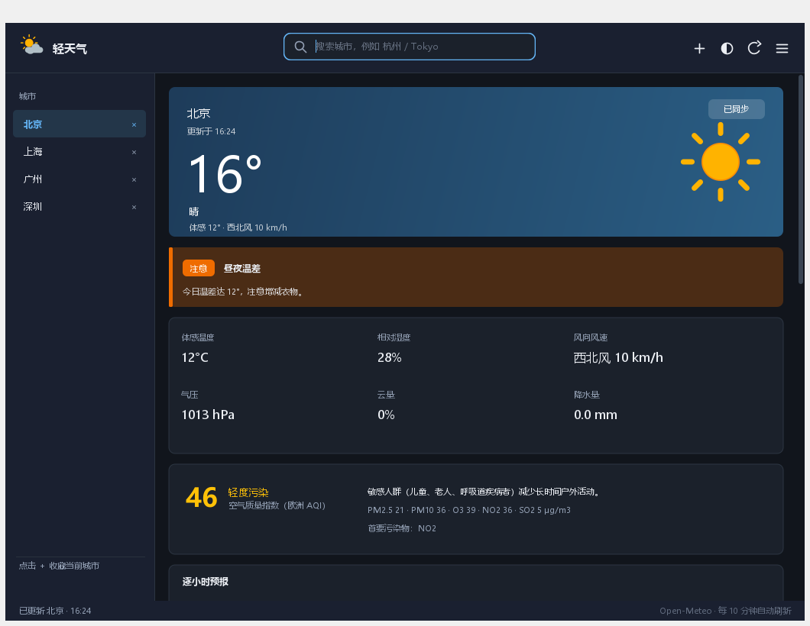

# 轻天气 · 桌面版（Windows）

纯 **Java 17 + Swing** 实现的天气客户端，界面由 Java2D 全部手绘（卡片、曲线、图标、悬停高亮），**零第三方依赖**（连 JSON 都是自带的 100 行解析器），打包成单文件入口 `LightWeather.exe`，自带精简 JRE。

> 与 Android 版（仓库根目录 `app/`）共享同一套数据源与产品思路：只用 Open-Meteo 的免费接口，不需要 API Key。



## 功能

| 模块 | 说明 |
| --- | --- |
| 实况卡 | 城市、更新时间、大号温度、天气描述、体感 / 风向 / 风速，背景随天气变色（晴/雨/雪/阴/夜），右上角「已同步」可点击刷新 |
| 六宫格指标 | 体感温度、相对湿度、风向风速、气压、云量、降水量 |
| 天气提醒 | 高温 / 严寒 / 大风 / 雷电 / 暴雨 / 强降雨 / 降雪 / 空气污染 / 昼夜温差，按 4 级严重度着色，多条合并显示 |
| 空气质量 | 欧洲 AQI 数值 + 等级 + 健康建议 + PM2.5/PM10/O3/NO2/SO2 + 首要污染物 |
| 逐时预报 | 逐小时温度、天气图标（昼夜自适应）、降水概率；**点击任意小时弹出详情**（温度/降水概率/降水量/湿度/风速） |
| 温度曲线 | 7 天高低温折线 + 渐变温度带 + 端点数值与日期标签 |
| 7 天列表 | 日期、图标、降水概率、最低温、温度区间条（蓝→橙渐变）、最高温 |
| 日出日落 | 日出、日落、昼长（「10 小时 59 分」） |
| 生活指数 | 穿衣、紫外线、洗车、运动、晾晒、感冒，本地规则计算 |
| 多城市 | 左侧城市栏，`＋` 收藏当前城市，行尾 `×` 移除（带确认） |
| 单位切换 | 温度 ℃/℉、风速 km/h · m/s · mph · 蒲福风级、气压 hPa · mmHg · inHg |
| 主题 | 跟随系统 / 强制浅色 / 强制深色 |
| 离线缓存 | 缓存完整的 API 原始 JSON，断网时直接渲染并标注「缓存数据」 |
| 自动刷新 | 每 10 分钟；`F5` 手动刷新，`Ctrl+F` 聚焦搜索 |

## 构建

```powershell
cd desktop
.\build.ps1              # 只编译到 build\classes
.\build.ps1 -Preview     # 编译 + 离屏渲染预览图（不需要真实桌面）
.\build.ps1 -Package     # 编译 + jar + jpackage app-image + zip
```

产物：

- `build\dist\LightWeather\LightWeather.exe` —— 免安装绿色版（目录内自带 `runtime\`）
- `build\dist\LightWeather-win64.zip` —— 便于分发的压缩包

要求：JDK 17（`jpackage` 随 JDK 提供）。无需 Gradle、无需 Android SDK、无需联网下载依赖。

> 想生成 `.msi` / `.exe` 安装器：安装 [WiX Toolset](https://wixtoolset.org/) 后把 `--type app-image` 换成 `--type msi` 即可。

## 自检 / 截图

```powershell
java -cp build\classes com.lightweather.desktop.App --screenshot build\shot.png --theme dark
java -cp build\classes com.lightweather.desktop.App --screenshot-frame build\window.png
java -cp build\classes com.lightweather.desktop.App --make-icon build\lightweather.ico
```

`--screenshot` 离屏渲染整块天气面板（会自动拉取真实数据）；
`--screenshot-frame` 创建真实窗口后把整个外壳画到图片里（含顶栏/侧栏）；
`--make-icon` 生成多尺寸友好的 ICO（PNG 负载，Vista+ 格式）。

## 数据源与隐私

- 天气/地理编码/空气质量：`api.open-meteo.com`、`geocoding-api.open-meteo.com`、`air-quality-api.open-meteo.com`
- 只发送经纬度或城市名，不收集任何设备信息，无统计上报。
- 本地文件仅 `%APPDATA%\LightWeather\settings.properties`（城市列表、单位、主题、离线缓存），删除即恢复默认。

## 代码结构

```
desktop/src/main/java/com/lightweather/desktop/
├── App.java             入口 + 截图/图标自检模式
├── MainFrame.java       窗口：顶栏（品牌/搜索/主题/刷新/菜单）+ 城市侧栏 + 状态栏
├── WeatherPanel.java    全部卡片的自绘面板（滚动、命中区、悬停）
├── Theme.java           浅色/深色配色与字体
├── Icons.java           天气图标矢量绘制
├── AppIcon.java         应用图标 + ICO 编码
├── Json.java            极简 JSON 解析/序列化
├── WeatherClient.java   HTTP（重试/超时）+ 解析
├── WeatherData.java     数据模型
├── WeatherCodes.java    WMO 代码映射
├── AirQuality.java      AQI/UV 分级与建议
├── LifeIndex.java       生活指数规则
├── WeatherAlert.java    预警规则
└── Prefs.java           设置持久化 + 离线缓存
```
